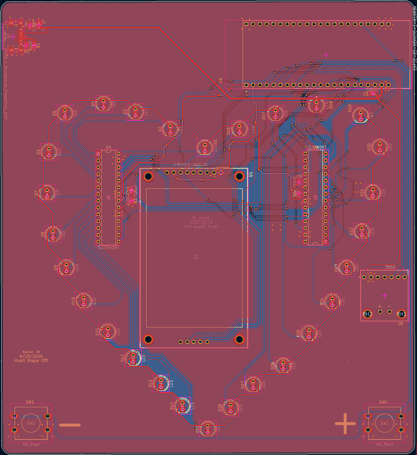
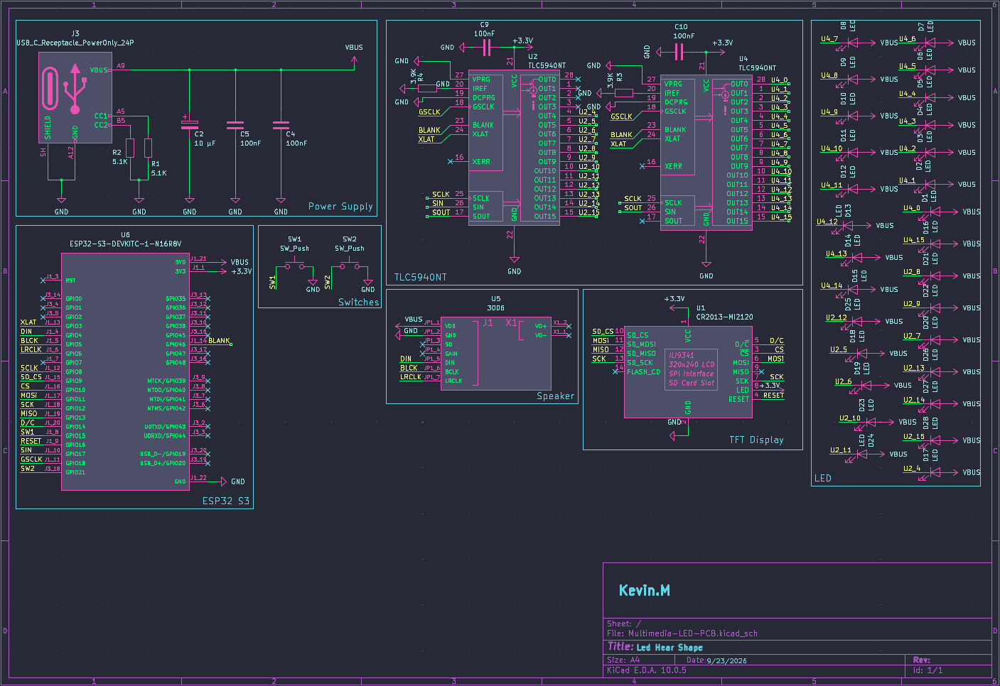
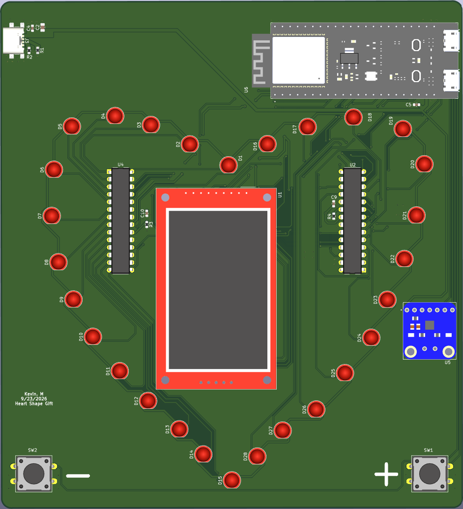
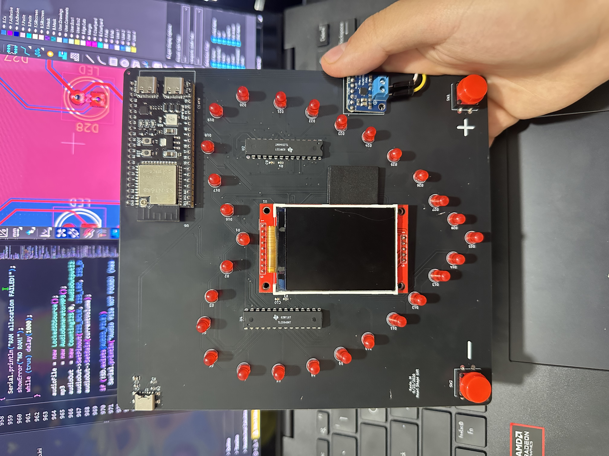

# ESP32-S3 Multimedia & LED Control PCB (KiCad)

A 2-layer, heart-shaped carrier PCB that combines an ESP32-S3, 28 PWM-dimmed LEDs, a TFT display with microSD, and I2S audio on one USB-C-powered board. Designed from scratch in KiCad, from schematic through layout.

## PCB Layout

## Schematic

## 3D Model

## Board

## Overview

The board is a carrier for an ESP32-S3-DevKitC-1 module. It takes 5 V from a USB-C connector, drives 28 LEDs through two daisy-chained TLC5940 16-channel PWM drivers, shows graphics on an ILI9341 TFT, reads files from that display's microSD slot, and plays audio through a MAX98357A I2S class-D amplifier and speaker. Two pushbuttons provide user input.

## Hardware

| Ref | Part | Role |
| --- | --- | --- |
| U6 | ESP32-S3-DevKitC-1-N16R8V | Microcontroller, Wi-Fi, 3.3 V logic supply |
| U2, U4 | TLC5940NT | 16-channel, 12-bit PWM constant-current LED drivers (daisy-chained) |
| D1–D28 | LEDs | 28 PWM-controlled LEDs |
| U1 | ILI9341 TFT module with microSD | Display and file storage over SPI |
| U5 | MAX98357A (Adafruit 3006) | I2S class-D audio amplifier |
| J3 | USB-C receptacle (power only) | 5 V input |
| R1, R2 | 5.1 kΩ | USB-C CC pull-downs (power sink) |
| R3, R4 | 3.9 kΩ | TLC5940 IREF current-set resistors |
| C4, C5, C9, C10 | 100 nF | Local decoupling |
| C2 | 10 µF | Bulk capacitance |
| SW1, SW2 | Pushbuttons | User input |

## System Design

**Power**
- USB-C power-only receptacle with 5.1 kΩ pull-downs on CC1 and CC2, so any USB-C charger supplies 5 V.
- 5 V feeds the LED drivers, LEDs and audio amplifier; the DevKitC's onboard regulator supplies 3.3 V to logic.
- 100 nF decoupling at each IC plus 10 µF bulk capacitance.

**LED control**
- Two TLC5940s chained on one serial bus: the ESP32 shifts data into the first driver (SIN), and its SOUT feeds the second. Shared SCLK, XLAT, BLANK and GSCLK lines control both.
- 28 of the 32 available channels drive LEDs (all 16 on one driver, 12 on the other).
- Per-channel current is set by the IREF resistor: I = (1.24 V / 3.9 kΩ) × 31.5 ≈ 10 mA, about 280 mA with every LED fully on.

**Display and storage**
- The TFT and microSD share one SPI bus (SCK, MOSI, MISO) with separate chip selects (CS, SD_CS) plus D/C and RESET lines for the display.

**Audio**
- Dedicated I2S lines (BCLK, LRCLK, DIN) from the ESP32 to the MAX98357A, which drives the speaker directly.

## Design Considerations

- Trace widths sized to current: wider traces for 5 V power and LED loads, 0.5 mm traces for logic signals.
- Power and high-current paths kept short; decoupling placed next to each driver.
- ERC and DRC checks run before fabrication.

## Repository Contents

- `hardware/SosoGift.kicad_sch`: schematic
- `hardware/SosoGift.kicad_pro`: KiCad project file
- `images/`: layout, schematic and 3D renders

## Skills Demonstrated

- Schematic capture and PCB layout in KiCad
- Power input design (USB-C sink) and power distribution
- Constant-current LED driver design and current budgeting
- SPI and I2S peripheral integration
- Component selection and design rule verification
